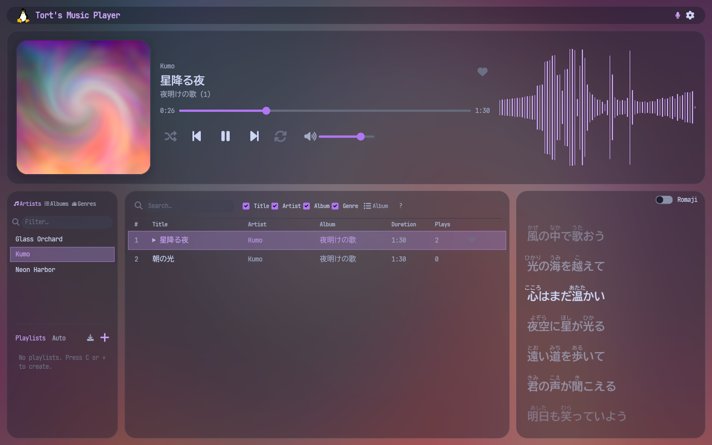
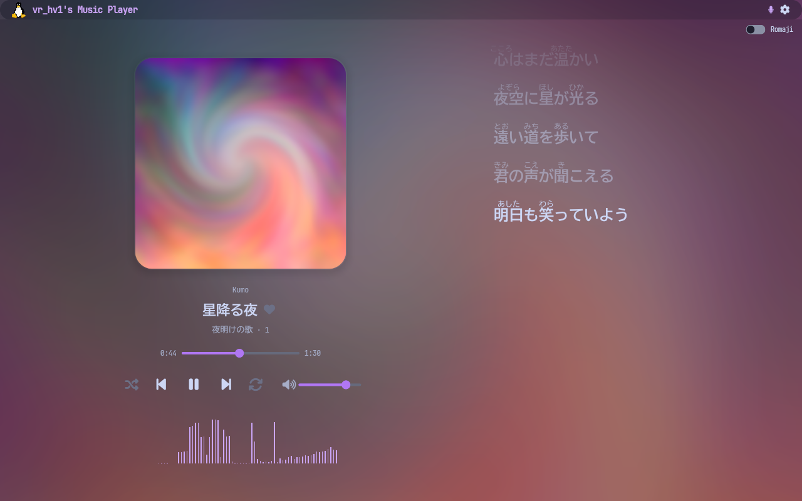
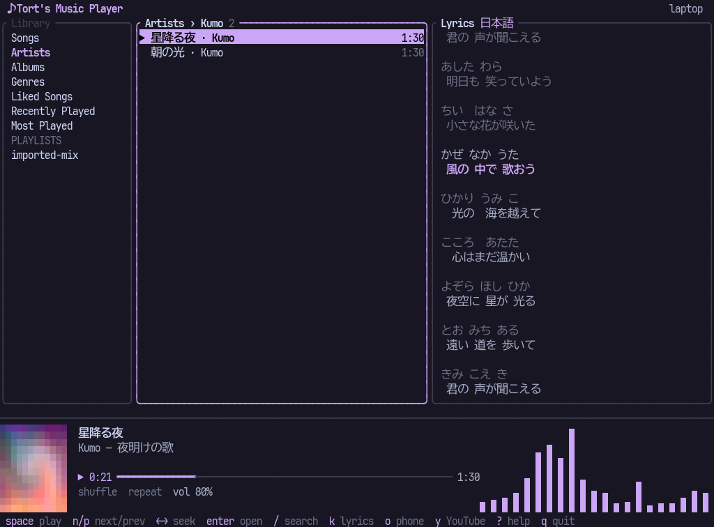
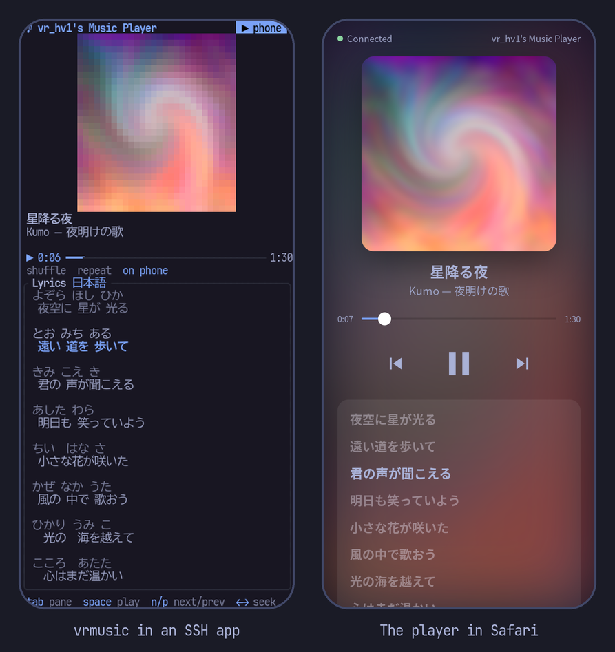

<div align="center">


# vr_hv1's music player

**A fast, native Linux music player with synced lyrics, furigana, romaji and YouTube downloads,**
**on your desktop, in a terminal, and on your phone.** It shows up on your desktop as *vr_hv1's Music Player*.

[](LICENSE)
[](https://www.rust-lang.org)
[](#requirements)
[](#requirements)



</div>

An enhanced fork of [lavanda](https://github.com/sheep-farm/lavanda), built for people who want more
control over how their player looks, who keep their music as local files, and who listen to a lot of
Japanese music.

## Contents

- [Highlights](#highlights)
- [Quick start (Arch Linux)](#quick-start-arch-linux)
- [Requirements](#requirements)
- [Installation](#installation)
- [Using it](#using-it)
- [Keyboard shortcuts](#keyboard-shortcuts)
- [Terminal client](#terminal-client)
- [Listen on your phone](#listen-on-your-phone)
- [Configuration](#configuration)
- [Desktop integration](#desktop-integration)
- [Privacy](#privacy)
- [Known limitations](#known-limitations)
- [Project layout](#project-layout)
- [Contributing](#contributing)
- [Credits](#credits)
- [License](#license)

## Highlights

**Lyrics**
- **Synced lyrics panel**: the line being sung lights up and the text glides along with the song.
  Click a line to jump there, or scroll to look around: it follows the song again 10 seconds after you
  stop. Drag the panel edge to resize it.
- Lyrics come from a `.lrc` file next to the song, the file's embedded lyrics, or [LRCLIB](https://lrclib.net).
  Lookups understand YouTube-style titles (`【Artist】Song (Official Video)`) and covers (`歌ってみた`, `Cover`).
- **Per-song timing fix**: if lyrics run early or late, right-click the line being sung, or nudge with `[` / `]`.
  The adjustment is remembered.
- Uploads with a translation woven in are skipped when a clean version exists.

**Japanese**
- **Furigana** above every kanji, using MeCab's grammar-aware readings (kakasi as a fallback).
- **Japanese ⇄ Romaji switch** in the lyrics panel. Both versions share the same timing, so switching
  never moves the highlighted line.

**Look and feel**
- Rounded, evenly spaced cards with an adjustable corner radius, plus optional glass (translucent) panels.
- **Blurred album-cover background** that dims bright covers and tints the lyrics to stay readable.
- Large framed cover art. YouTube thumbnails are shown whole instead of cropped and zoomed in.
- A sensitive, mirrored spectrum visualiser that follows the music's loudness.
- Nine built-in themes, or follow your [Omarchy](https://omarchy.org) theme live.
- Focus layout (`t`): big cover, lyrics alongside, library hidden.



**Library and downloads**
- **YouTube search and download** (`y`) through yt-dlp, with a large cover preview and automatic retries.
- **Import from a link**: paste a link to a song, a playlist or an album (YouTube, YouTube Music or any
  site yt-dlp supports) and download one song, or all of them into a new playlist.
- **Playlist files**: export a playlist as a tiny CSV of YouTube IDs and import it on another machine.
  Songs you already have are linked, and missing ones are downloaded.
- Plays MP3, FLAC, OGG, Opus, WAV, AAC, M4A, AIFF and more. Browse by artist, album or genre.
- Liked songs, play counts, Recently Played and Most Played lists, multi-select and a tag editor.

**Desktop**
- **System tray icon** with play/pause, next, previous and a song tooltip.
- **MPRIS2**: works with `playerctl`, Waybar, media keys and desktop widgets.
- Desktop notifications when the track changes.

**Terminal and phone**
- **Terminal client** (`vrmusic`) with the same library, lyrics, furigana, romaji, YouTube and
  playlists, album art drawn in the terminal, and mouse/touch support. It fits a phone screen over SSH.
- **Listen on your phone**: press `o` and the music plays in your phone's browser (lock-screen controls,
  synced lyrics), reached privately over Tailscale or an SSH tunnel.

## Quick start (Arch Linux)

```bash
# Build tools, runtime and fonts (already use rustup? leave out `rust`)
sudo pacman -S --needed base-devel git rust alsa-lib yt-dlp ffmpeg curl kakasi \
    noto-fonts-cjk ttf-jetbrains-mono-nerd libnotify xdg-desktop-portal-gtk

# Better Japanese readings (optional, from the AUR)
yay -S mecab-git mecab-ipadic

# Build and install for your user (to ~/.local)
git clone https://github.com/CodingTort/vr_hv1-music-client.git
cd vr_hv1-music-client
make install
```

Then install the [UDEV Gothic NF](#fonts) font, make sure `~/.local/bin` is on your `PATH`, and launch
**vr_hv1's Music Player** from your app launcher or run `lavanda`. Your music is read from `~/Music`.
In a terminal (or over SSH), run `vrmusic`.

## Requirements

### To build

| Dependency | Why | Arch | Debian / Ubuntu | Fedora |
|---|---|---|---|---|
| Rust **1.89 or newer** | compiler | `rust` (or `rustup`) | use [rustup](https://rustup.rs): distro packages are too old | `rust cargo` |
| C toolchain and `make` | linking, `make install` | `base-devel` | `build-essential` | `gcc make` |
| `pkg-config` | finds ALSA | `pkgconf` (in `base-devel`) | `pkg-config` | `pkgconf-pkg-config` |
| ALSA headers | audio output | `alsa-lib` | `libasound2-dev` | `alsa-lib-devel` |

### To run

These are already present on any normal Linux desktop:

- A **Wayland** compositor (tested on Hyprland) or an **X11** session
- Working **GPU drivers** (Vulkan or OpenGL, e.g. Mesa)
- **PipeWire**, PulseAudio or plain ALSA for sound
- A **D-Bus** session bus (for MPRIS and the tray icon)

### Optional features

Everything below is optional. When a tool is missing, the app keeps working without that one feature
(the YouTube and Romaji features tell you what to install).

| Feature | Needs | Arch | Debian / Ubuntu | Fedora |
|---|---|---|---|---|
| YouTube search and download | `yt-dlp`, `ffmpeg` | `yt-dlp ffmpeg` | `yt-dlp ffmpeg` (or yt-dlp's [official release](https://github.com/yt-dlp/yt-dlp#installation), which stays current) | `yt-dlp ffmpeg` (RPM Fusion) |
| Online lyrics, YouTube thumbnails | `curl` | `curl` | `curl` | `curl` |
| Romaji and furigana | `kakasi` | `kakasi` | `kakasi` | `kakasi` |
| Accurate Japanese readings (recommended alongside kakasi) | `mecab` with the IPAdic dictionary | AUR: `mecab-git mecab-ipadic` | `mecab mecab-ipadic-utf8` | `mecab mecab-ipadic` |
| Track-change notifications | `notify-send` | `libnotify` | `libnotify-bin` | `libnotify` |
| File dialogs (background image, playlist import/export) | an XDG desktop portal | `xdg-desktop-portal-gtk` (or `-hyprland`, `-kde`) | `xdg-desktop-portal-gtk` | `xdg-desktop-portal-gtk` |
| Tray icon | a StatusNotifierItem tray (Waybar `tray`, KDE, GNOME with AppIndicator) | — | — | — |
| "Show window" from the tray | Hyprland (`hyprctl`) | — | — | — |
| Live theme following | [Omarchy](https://omarchy.org) | — | — | — |
| Command-line control | `playerctl` | `playerctl` | `playerctl` | `playerctl` |
| [Listening on your phone](#listen-on-your-phone) without an SSH tunnel | [Tailscale](https://tailscale.com) on the computer and the phone | `tailscale` | [tailscale.com/download](https://tailscale.com/download) | `tailscale` |
| Keeping the terminal client running when SSH disconnects (`vrmusic` uses it when installed) | `tmux` | `tmux` | `tmux` | `tmux` |
| Phone playback of OGG, Opus and other formats Safari can't play | `ffmpeg` | `ffmpeg` | `ffmpeg` | `ffmpeg` (RPM Fusion) |

### Fonts

| Font | Used for | Install |
|---|---|---|
| **UDEV Gothic NF** | all text: Latin and Japanese in one matching style | Download `UDEVGothic_NF_*.zip` from the [UDEV Gothic releases](https://github.com/yuru7/udev-gothic/releases), copy the `UDEVGothicNF-*.ttf` files to `~/.local/share/fonts/`, then run `fc-cache -f` |
| **JetBrainsMono Nerd Font** | icons | Arch: `ttf-jetbrains-mono-nerd`, others: [nerdfonts.com](https://www.nerdfonts.com/font-downloads) |
| **Noto Sans CJK** | fallback for Chinese/Korean/Japanese text | Arch: `noto-fonts-cjk`, Debian: `fonts-noto-cjk`, Fedora: `google-noto-sans-cjk-fonts` |

## Installation

```bash
git clone https://github.com/CodingTort/vr_hv1-music-client.git
cd vr_hv1-music-client
make install          # builds in release mode, installs to ~/.local
```

The first build takes about 2 minutes on a recent 8-core or larger machine (longer on fewer cores);
rebuilding after changing the code takes under half a minute.

`make install` puts these files in place:

| File | Location |
|---|---|
| desktop app | `~/.local/bin/lavanda` |
| terminal client, and `vrmusic`, which runs it in tmux | `~/.local/bin/vrmusic-tui`, `~/.local/bin/vrmusic` |
| app launcher entry | `~/.local/share/applications/lavanda.desktop` |
| icon | `~/.local/share/icons/hicolor/{scalable,256x256}/apps/tort-music-player.*` |

To install system-wide instead, build as yourself, then copy the files as root:
`make && sudo make install-files PREFIX=/usr/local`. To remove it again, run `make uninstall` with the
same `PREFIX` (and `sudo` for a system-wide install).

Other useful targets: `make` (build only), `make test` (run the test suite), `make run`.

> The program is called `lavanda` because its settings and library data live in `~/.config/lavanda`,
> shared with the original project. If you are coming from lavanda, your library, playlists and settings
> carry over.

## Using it

**Your library.** Put music in `~/Music` (or set `music_dir`). It is scanned at start-up; press `F5` after
adding files. Browse by Artists, Albums or Genres in the sidebar. Covers come from the file's embedded art,
or from `cover.jpg` / `folder.jpg` next to it.

**Lyrics.** Press `k` or click the microphone button. To use your own lyrics, save a `.lrc` file with
the same name as the song next to it. If the lyrics are early or late, right-click the line that is being
sung right now; the offset is saved for that song.

**Japanese songs.** Use the **Romaji** switch at the top of the lyrics panel. Japanese mode shows furigana
over the kanji. Install MeCab for the most accurate readings: without it, kakasi is used, which
sometimes misreads conjugated verbs and set phrases.

**YouTube.** Press `y`, type a search and press Enter. Pick a result with `↑` / `↓` or a click to see its
cover, then press Enter or **Download** to download it into your library.
Files are tagged automatically, including the video ID, which playlist files rely on.

**Links.** Paste a link into the same box instead of a search: a song, a playlist or an album (from
YouTube, YouTube Music, or any site yt-dlp supports), then press Enter. A playlist or album lists all its
songs: download one, or click **Download all into a playlist** (`A` in the terminal client) to download
the songs you don't have yet into a new playlist named after it, in the same order. The playlist is
filled in when the last download finishes.

**Playlist files.** Select a playlist and click its export icon to save a `.csv`. Use the import icon next
to `+` to load one: matching songs are linked, and missing ones are downloaded from YouTube one by one.
The format is `youtube_id,title,artist`, one song per line.

**Settings.** Click the gear icon or press `Ctrl+,` to change the theme, glass panels, corner radius,
background (colour, gradient, image or blurred album cover), cover size and visualiser style.

## Keyboard shortcuts

| Key | Action | | Key | Action |
|---|---|---|---|---|
| `Space` | play / pause | | `k` | lyrics panel |
| `n` / `p` | next / previous | | `[` / `]` | lyrics 0.5 s earlier / later |
| `→` / `←` | seek | | `t` | focus layout |
| `+` / `-` | volume | | `v` | visualiser |
| `s` / `r` | shuffle / repeat | | `y` | YouTube search |
| `↑` / `↓`, `Enter` | move, play | | `c` / `a` | new playlist / add to playlist |
| `/` | clear the search | | `l` | like |
| `F5` | rescan library | | `e` | edit tags |
| `Ctrl+,` | settings | | `?` | all shortcuts |

Mouse: double-click a track to play it, right-click for context menus, `Ctrl+Click` / `Shift+Click` to
select several.

## Terminal client



`vrmusic` opens the same player in the terminal (it has its own page, with downloads and an iPhone guide:
[vr_hv1-music-player-TUI-VERSION](https://github.com/CodingTort/vr_hv1-music-player-TUI-VERSION)): it uses the same library, playlists, likes, lyric
timing fixes and settings as the desktop app (run one of the two at a time). It works in any terminal
with 24-bit colour, including SSH apps on phones, and adapts to the size of the screen:

- **Wide terminals** show the library, the song list and the lyrics side by side, with the album art,
  progress and visualiser below.
- **Narrow ones** (a phone held upright) show one pane at a time: switch with `Tab` or tap the tabs at the top.
- **`t`** switches to a now-playing view with big album art and the lyrics.

| Key | Action | | Key | Action |
|---|---|---|---|---|
| `Space` | play / pause | | `k` | lyrics pane |
| `n` / `p` | next / previous | | `j` | Japanese ⇄ romaji |
| `←` / `→` | seek (`Shift`: 30 s) | | `g` | furigana on / off |
| `+` / `-` | volume | | `[` / `]`, `0` | lyrics earlier / later, reset |
| `s` / `r` | shuffle / repeat this song | | `S` | sync the selected lyric line to now |
| `Enter` | play / open artist, album… | | `c` / `a` / `d` | new playlist / add / remove song |
| `Esc` / `⌫` | back, clear search | | `R` / `D` | rename / delete playlist |
| `/` | search | | `x` / `i` | export / import playlist (CSV) |
| `Tab`, `1` `2` `3` | switch pane | | `y` | YouTube search and download |
| `t` | now-playing view | | `o` / `O` | play on your phone ⇄ this computer / show the phone code |
| `l` | like | | `e` | edit tags |
| `v` | visualiser | | `,` | settings |
| `F5` | rescan library | | `?` | all keys |

Mouse and touch: click or tap to select, double-click to play, scroll, click the progress bar to seek,
click a lyric line to jump to it. After you scroll the lyrics, they follow the song again 10 seconds later. Messages the player would print go to `~/.cache/lavanda/tui.log`.

## Listen on your phone

<p align="center"></p>

Press `o` in the terminal client and the music moves to your phone: it plays in the phone's browser
(Safari on an iPhone), with the album art, synced lyrics (kept centred on the line being sung; scroll them
freely, and they return to it 10 seconds after you stop) and lock-screen controls, in the player's theme. The terminal client
stays the remote control, and the page has its own play, pause and skip buttons. Press `o` again to bring
the music back to the computer at the same spot.

The page is served by the terminal client itself. It listens only on the computer itself and on its
Tailscale address, never on your other networks. A phone gets in with a 6-digit code shown in the
terminal (5 tries, 10 minutes), which hands it the player's secret key.

**With Tailscale** (recommended): install Tailscale on the computer and the phone, signed in to the same
account. Press `o`: the terminal shows a short address such as `http://my-laptop:8337` and a 6-digit
code. Open the address in Safari and enter the code (it works for 10 minutes; `O` shows a new one). You
land on the player, whose link now carries the key: tap **Share › Add to Home Screen** to keep it as an app.

**With an SSH tunnel**: connect with a port forward, e.g. `ssh -L 8337:127.0.0.1:8337 you@your-computer`
(in Termius: *Port Forwarding*, local, 8337 → 127.0.0.1:8337), press `o`, open `http://localhost:8337` and
enter the code. On an iPhone the tunnel stops a short while after you switch away from the SSH app, so
Tailscale works better there.

**Over SSH, start it with `vrmusic`**: it runs the player inside tmux, so the player keeps going when the
SSH app on your phone is suspended, and running `vrmusic` again takes you back to it. (`vrmusic-tui` runs
the player directly, without tmux.)

Tips: the first song needs a tap (phones don't start sound on their own). With the phone locked, songs
still move on by themselves and the lock-screen buttons work; commands from the terminal reach the page
when it's back on screen. `vrmusic --phone` starts straight in phone mode.

## Configuration

Settings are written to `~/.config/lavanda/config.toml` on first launch. Most of them can be changed in
the Settings dialog; every option is listed here:

```toml
music_dir = "~/Music"            # your library, scanned at start-up
volume = 0.8
shuffle = false
repeat = false
language = "auto"                # "auto", "en", "pt_BR", "es" (translates only a few labels)
seek_step = 5                    # seconds per ← / →
volume_step = 0.05

# Appearance
theme_mode = "auto"              # "auto" follows Omarchy, "manual" uses theme_preset
theme_preset = "lavender"        # lavender, vampire, cotton candy, catppuccin mocha,
                                 # tokyo night, nord, gruvbox, everforest, rose pine
use_glassmorphism = true         # translucent panels
corner_radius = 10.0
background_kind = "none"         # "none", "color", "gradient", "image", "album" (blurred cover)
background_color = "#11111b"
background_gradient_from = "#1e1b2e"
background_gradient_to = "#0f0e17"
background_gradient_angle = 135.0
background_image = ""
cover_size = 240.0               # 140–400 px
spectrum_style = "mirrored"      # "mirrored" or "bottom"

# Lyrics
lyrics_online = true             # look lyrics up on lrclib.net; false = local files only

# YouTube (yt-dlp)
yt_dlp_path = "yt-dlp"
yt_dlp_format = "mp3"            # any format yt-dlp's --audio-format accepts
yt_dlp_quality = "128K"
yt_dlp_output = "%(title)s.%(ext)s"
yt_search_results = 15

# Terminal client
phone_port = 8337                # port of the phone player page
```

| Data | Where |
|---|---|
| settings | `~/.config/lavanda/config.toml` |
| volume, lyrics panel (shown, width, romaji) | `~/.config/lavanda/state.toml` |
| playlists, likes, play counts, lyric offsets | `~/.config/lavanda/db.json` |
| downloaded lyrics | `~/.cache/lavanda/lyrics/` |
| the phone player's secret key (delete it to make a new one) | `~/.config/lavanda/phone-key` |
| terminal client log; songs converted for the phone | `~/.cache/lavanda/tui.log`, `~/.cache/lavanda/phone/` |

## Desktop integration

**Waybar.** The tray icon appears in Waybar's `tray` module. To show the current song, add an `mpris` module:

```jsonc
"mpris": {
    "format": "{player_icon}  {title} — {artist}",
    "player-icons": { "lavanda": "󰝚", "default": "󰝚" },
    "on-click": "playerctl -p lavanda play-pause",
    "on-scroll-up": "playerctl -p lavanda next",
    "on-scroll-down": "playerctl -p lavanda previous"
}
```

**Global shortcuts (Hyprland).**

```ini
bind = , XF86AudioPlay, exec, playerctl -p lavanda play-pause
bind = , XF86AudioNext, exec, playerctl -p lavanda next
bind = , XF86AudioPrev, exec, playerctl -p lavanda previous
```

**Tray icon.** Left click shows the window, middle click plays or pauses, scrolling skips tracks, and
right click opens the menu.

## Privacy

The player works fully offline. It only goes online for these:

| What | Sends | To |
|---|---|---|
| Lyrics lookup (turn off with `lyrics_online = false`) | the playing song's title, artist and length | lrclib.net |
| YouTube search and download | your search text, the link you pasted, or the video you picked | YouTube (or the pasted link's site), via yt-dlp |
| Search-result thumbnails and cover previews | the video ID | i.ytimg.com |
| "Search cover online" in the tag editor (only when you click it) | the album's artist and title | Google Images, in your browser |

Nothing else leaves your computer. The phone player (terminal client, `o`) serves your music only on the
computer itself and its Tailscale address, and only to links that carry its secret key.

## Known limitations

- The interface is in English. The `language` setting only translates the "No track" and "Unknown"
  placeholders (into Portuguese or Spanish).
- Without MeCab, furigana and romaji come from kakasi, which sometimes misreads conjugated verbs and set
  phrases. Lyrics can also contain words that are written one way and sung another; furigana show the
  dictionary reading.
- The prebuilt release needs glibc 2.43 or newer (current Arch-based systems); elsewhere, build from source.
- "Show window" from the tray works on Hyprland; on other desktops, use your task bar.
- Seek accuracy depends on the file format, and there is no gapless playback.
- Run the desktop app or the terminal client, not both: they would both play, and only one gets the
  media keys.
- The terminal client's album art needs a terminal with 24-bit colour (almost all have it).
- Phone playback is controlled from the page and the terminal; while the phone is locked, commands from
  the terminal wait until the page is on screen again (the lock-screen buttons always work).

## Project layout

```
src/
├── main.rs, app.rs         application state, messages, window
├── lyrics.rs               lyrics lookup, LRC parsing, romaji, furigana (MeCab / kakasi)
├── youtube.rs              yt-dlp search and download
├── playlist_io.rs          playlist CSV export / import
├── tray.rs                 system tray icon (StatusNotifierItem + dbusmenu)
├── cover.rs                album covers squared without cropping (shared)
├── config.rs, state.rs, persist.rs, locale.rs
├── audio/                  decoding and output, spectrum analysis, MPRIS
├── library/                library scanner, track model
└── ui/
    ├── theme.rs, icons.rs
    ├── views/              library, player, focus layout, lyrics panel
    └── components/         lyrics view, visualiser, dialogs, controls
src/tui/                    the terminal client (a second program sharing the modules above)
├── main.rs, app.rs         startup, state and behaviour
├── view.rs, input.rs, art.rs   drawing, keys and mouse, album art in the terminal
└── phone.rs, phone.html    the phone player: small web server and the page
assets/                     icon (Tux) and desktop entry
```

## Contributing

Bug reports and pull requests are welcome. See [CONTRIBUTING.md](CONTRIBUTING.md). Changes are listed in
the [changelog](CHANGELOG.md).

## Credits

- Based on [**lavanda**](https://github.com/sheep-farm/lavanda) by Flavio de Vasconcellos (MIT).
- Icon: [**Tux**](https://commons.wikimedia.org/wiki/File:Tux.svg) by Larry Ewing (lewing@isc.tamu.edu), created with The GIMP.
- Lyrics from [**LRCLIB**](https://lrclib.net), a free and open lyrics database.
- Japanese readings by [**MeCab**](https://taku910.github.io/mecab/) and [**KAKASI**](http://kakasi.namazu.org/).
- Downloads by [**yt-dlp**](https://github.com/yt-dlp/yt-dlp). Font: [**UDEV Gothic**](https://github.com/yuru7/udev-gothic) by Yuko Otawara.
- Built with [iced](https://iced.rs), [ratatui](https://ratatui.rs), [Symphonia](https://github.com/pdeljanov/Symphonia), [cpal](https://github.com/RustAudio/cpal), [lofty](https://github.com/Serial-ATA/lofty-rs) and [zbus](https://github.com/dbus2/zbus).

Please only download music you have the right to download.

## License

[MIT](LICENSE). Copyright © 2026 CodingTort, and © 2026 Flavio de Vasconcellos for the original lavanda code.
